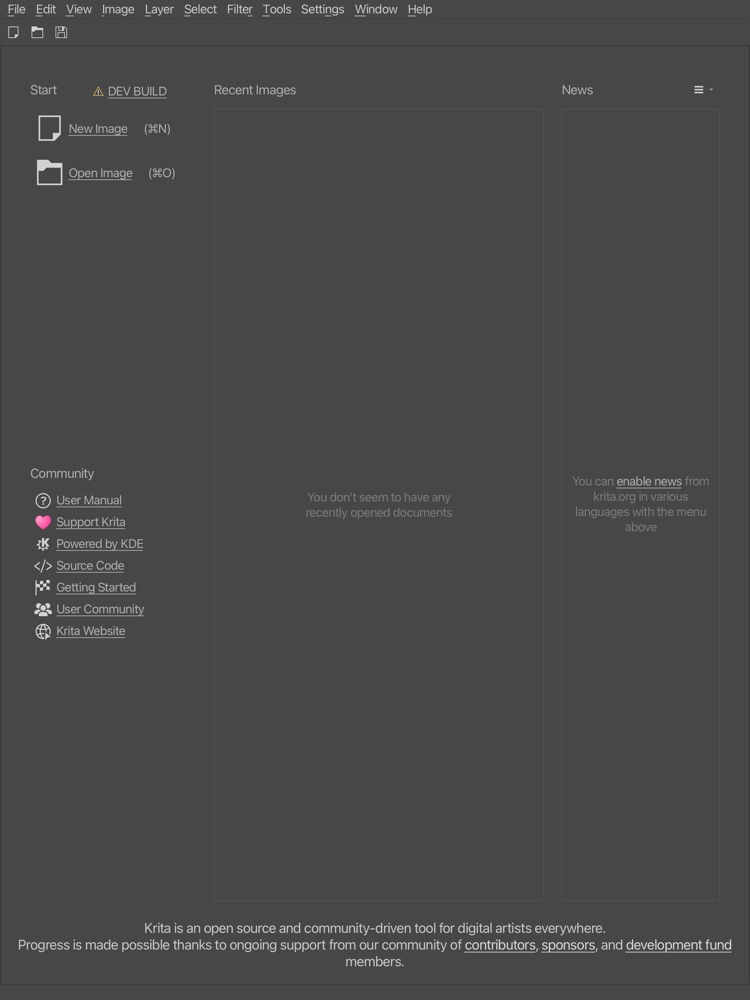
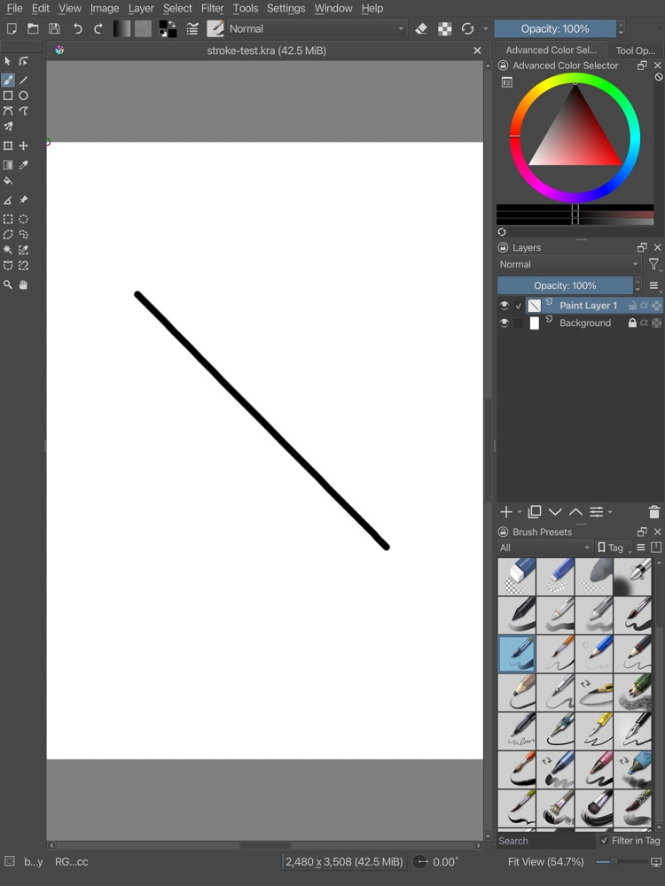

# Krita on the iPad simulator: Phase 4 build record

Phase 4 of the personal iPadOS port (see `IOS_PORT_PLAN.md`): Krita itself compiled for iOS against the Phase 3 dependency prefix (`IOS_DEPS_BUILD.md`) and run on the iOS simulator.

**Result:** every Phase 4 milestone passes on the simulator (iPad Pro 13-inch M5, iOS 27.0):

1. Krita links.
2. It launches.
3. A canvas draws.
4. A brush stroke paints.
5. It saves a `.kra` through the iOS Files picker.
6. It opens that `.kra` again in a fresh app session.

The device build, signing and Apple Pencil are Phase 5.

| Welcome screen | New document, one stroke | `stroke-test.kra` reopened after a restart |
|---|---|---|
|  |  |  |

## The build

| | |
|---|---|
| Configuration | Ninja, RelWithDebInfo, `-DBUILD_WITH_QT6=ON -DALLOW_UNSTABLE=QT6 -DBUILD_TESTING=OFF`, toolchain `ios-toolchain-krita.cmake` from the deps fork, ccache. `KRITA_STATIC_BUILD` is on by default for iOS, with the 17-plugin painting allowlist |
| Compile | About 3,900 objects, at 4 parallel jobs. A full compile took about 20 minutes over several passes; relinks take about 10 seconds |
| Result | `bin/krita.app` with a 160 MB arm64 simulator executable (`platform 7`, `minos 17.0`). It links 47 Krita libraries and 17 Krita plugins whole-archive |
| Qt plugins | No `Q_IMPORT_PLUGIN` needed: Qt's CMake linked the iOS platform plugin, SQLite, the image formats, SVG and the QtQuick, Controls 2 and Templates 2 QML plugins, plus Krita's own `org.krita.components` |
| App bundle | `cmake --install` into a staging prefix. `share/` (54 MB of resources, 32 MB of translations) and `lib/qml` are copied into `krita.app`, because `KoResourcePaths` uses the executable's directory as the install prefix on iOS. Signed ad hoc. 242 MB in all |
| Scripts | In `/Volumes/Krita/krita-ios/scripts`: `krita-env.sh`, `build-krita.sh <sdk> [targets]` and `run-krita-sim.sh` (assemble, sign, install, launch, screenshot) |

## What Krita needed

| Change | Where | Why |
|---|---|---|
| `QProcess` behind `QT_CONFIG(process)` | `libs/widgetutils/xmlgui/kcheckaccelerators.cpp`, `kbugreport.cpp`, `libs/ui/animation/KisFFMpegWrapper.{h,cpp}` | Qt for iOS has no `QProcess`, and Android's Qt does, so these were never guarded. The external-ffmpeg wrapper now reports "Running external programs is not supported on this platform" instead of starting a process. The in-process encoder is unaffected |
| `QT_OPENGL_ES_2` defined for Qt 6 mobile builds | `libs/ui/CMakeLists.txt` | Qt 5 defined it for GLES-only builds; Qt 6 only has `QT_CONFIG(opengles2)`. Without it Krita's GL code took the desktop paths, which use ARB/ATI constants the GLES headers lack |
| `GL_HALF_FLOAT_OES`, `GL_RGBA32F_EXT`, `GL_MULTISAMPLE_EXT` fallbacks | `kis_opengl_image_textures.cpp`, `kis_mirror_axis.cpp` | Apple ships the first two only in its ES2 headers (Qt includes ES3) and the third not at all |
| `setOrientationUpdateMask` only for Qt 5 | `libs/ui/KisMainWindow.cpp` | Removed in Qt 6, which always reports orientation changes |
| LibAV's `-framework X` pairs re-joined | top-level `CMakeLists.txt` | FindPkgConfig keeps "-framework" and "X" as separate link options and CMake de-duplicates the repeated "-framework", so the linker took `AudioToolbox` etc. for file names |
| Static fontconfig links expat | top-level `CMakeLists.txt` | The find module does not add expat (listed under `Requires` in `fontconfig.pc`). It was the only undefined symbol at link |
| `install(TARGETS)` skips static libraries in a static build | `cmake/modules/KritaStaticBuild.cmake` | Plugins outside the allowlist are not built but kept their install rules, so `cmake --install` failed. Static libraries are never needed after the link anyway (they were 2 GB of the install). The override forwards every other `install()` call unchanged |
| No splash screen on iOS | `krita/main.cc` | Not wanted on the iPad; it was also the first window to hit the startup problem below |
| Start Krita once UIKit reports the app active | `krita/main.cc`, new `krita/ios/KisIosApplicationState.{h,mm}` | `main()` runs inside UIKit's launch callback, and iOS refuses GL calls until the app is active. Qt reports `Qt::ApplicationActive` when the window scene activates, which was about 1.3 s before `UIApplicationDidBecomeActiveNotification`. Krita's start-up fits inside that gap. So `KisApplication::start()` now runs from the event loop on UIKit's notification (or at once if the app is already active) |

## Two Qt fixes (deps fork `ios` branch, `ec482d1`, `ext_qt` iOS branch)

Both are applied by the recipe and were rebuilt into both prefixes. Each touched one file, and the incremental rebuild took about 12 s.

| Patch | Bug |
|---|---|
| `0001-Frame-compression-do-not-dereference-a-null-QRhi.patch` | The fork's frame-rate compression (`QWidgetRepaintManager::slotCompressedUpdate`) calls `rhi(window)->isOneButLastFrameCompletedOnGPU()` without checking for null. The QRhi is null when it could not be created, so Krita crashed in `KisSplashScreen::show()` and then in the main window's first `show()` |
| `0002-iOS-re-enable-GL-once-the-application-is-no-longer-suspended.patch` | `QIOSContext::verifyGraphicsHardwareAvailability()` sets a static "backgrounded" flag on the first GL call, and clears it only on a later state transition. Krita probes GL in `main()`, before the event loop, while `QGuiApplication::applicationState()` still reads Suspended; UIKit's transitions had already been emitted. So every later GL call was refused, about 1,000 per start-up, and the window stayed black. The patch clears the flag once Qt's state is no longer Suspended. Upstream Qt has the same code, so it is probably worth reporting |

## How it was verified

All on the simulator, by tapping through the UI and taking screenshots:

- **Start-up:** the app launches to the welcome screen, with menus, toolbar and the dev-build notice. Resources load from `Documents/Resources`; the default bundle is found there.
- **New document:** the dialog opens with its defaults (2480×3508, 300 ppi, RGB/Alpha 8-bit, sRGB-elle-V2). Create shows the canvas with the toolbox, Advanced Colour Selector, Layers (Paint Layer 1 over Background) and Brush Presets.
- **Painting:** a finger drag paints an anti-aliased stroke with the default pen, and the title shows the document modified.
- **Saving:** Save opens the native iOS document picker in the app's "Krita" folder (On My iPad). Saved as `stroke-test.kra`, 301 KB, the archive checks out: `mimetype` is `application/x-krita`, it holds two layers with ICC profiles, and its 2480×3508 merged image shows the stroke.
- **Opening:** after restarting the app, File › Open (native picker) › `stroke-test.kra` opens the document with the stroke and both layers.

## Known issues (none blocking)

- The save picker suggests "Pictures" with no extension (`KoFileDialog::onFilterSelected: Cannot find suffix for filter ""`). Typing `name.kra` works.
- Recent Images was empty after a restart. The app was killed with `simctl terminate`, so settings may not have been written; check with a normal quit or a background/foreground cycle.
- `QPainter::begin: Paint device returned engine == 0, type: 3` repeats while drawing: some widget paints into a null image. It has no visible effect so far.
- `Documents/` shows `krita-backup/` in the Files app next to `Resources/`.
- **Not tried yet:** text tool and Text Properties docker (QML), filters, transform tool, animation and recorder export, memory limits, rotation.
- **Simulator limits:** touches arrive as mouse events, there is no Pencil, and GL runs on Apple's software renderer.
- **Still missing:** an app icon. The welcome page shows "DEV BUILD".

## For Phase 5 (device)

- **Configure:** the same configure line with `KDECI_IOS_SDK=iphoneos`, against `deps-iphoneos`. That prefix already has both Qt fixes.
- **Signing:** the bundle needs real signing (team `5U93YR33HD`, bundle id `org.krita.ipad`). Either build with the Xcode generator and `-DKRITA_IOS_DEVELOPMENT_TEAM=5U93YR33HD`, or sign the Ninja-built bundle with `codesign` and a development profile.
- **Install:** `xcrun devicectl device install app` with the iPad connected.
- **Check on the device:** Pencil pressure and tilt, which the simulator cannot test, and memory use with large documents.
