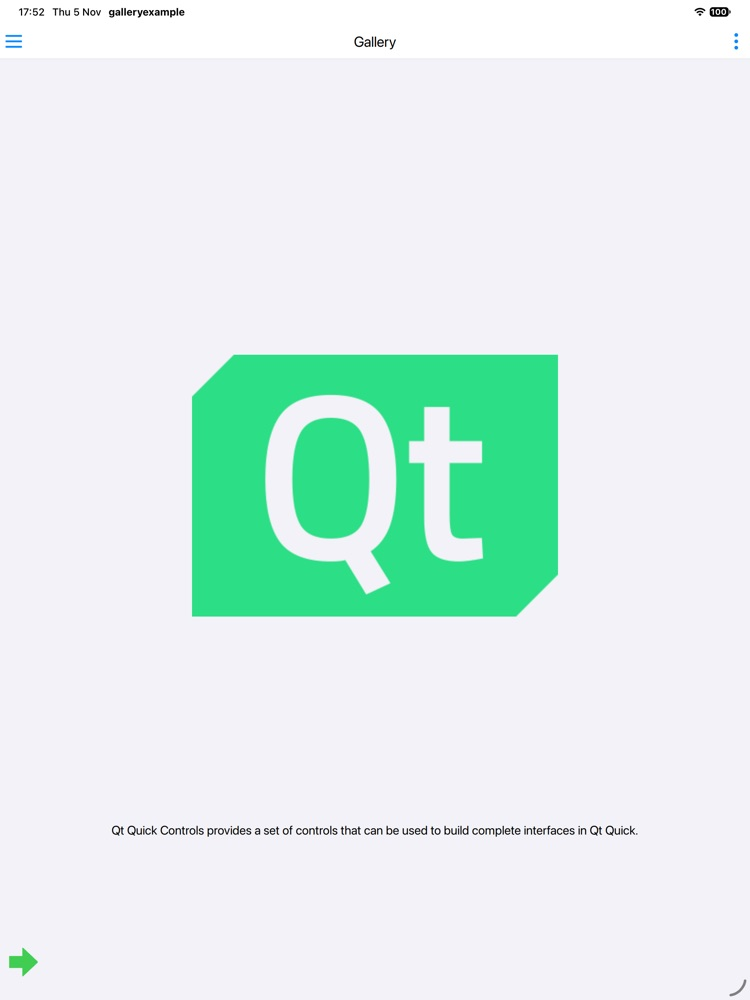
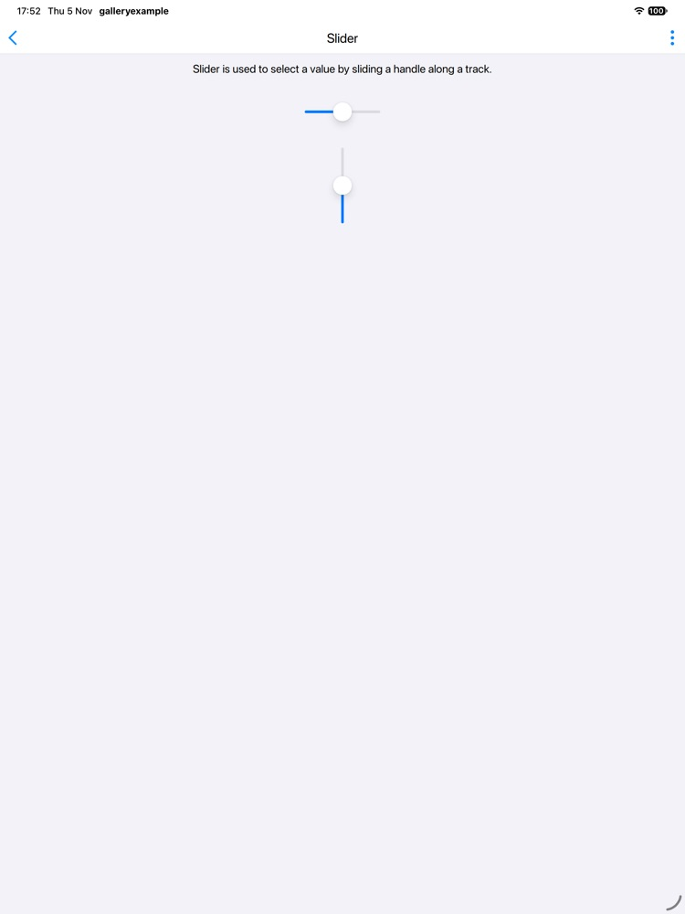

# Qt 6 for iPadOS: Phase 2 build record

Phase 2 of the personal iPadOS port (see `IOS_PORT_PLAN.md`, "Brief for the Mac: Phase 2"). Static Qt 6 is built for the arm64 device and the arm64 simulator, proven with three Qt examples on the simulator and one signed device-SDK example, and captured as a recipe in the `krita-deps-management` fork.

**Result:** Krita's Qt fork built for iOS against Xcode 27.1 without any patch. Every configure line below ran unchanged. The only complaint was a CMake warning that Qt 6.11.3 is tested only up to SDK 26.

## Machine and tools

| | |
|---|---|
| Mac | MacBook Air, Apple M4, 10 cores, 16 GB, macOS 27.0.1 (26A434) |
| Xcode | 27.1 (27A9275), Apple clang 21.0.0 (clang-2100.3.34.2) |
| SDKs | iPhoneOS 27.1, iPhoneSimulator 27.1, macOS 27.0 (host tools) |
| Simulator | iPad Pro 13-inch (M5), iOS 27.0 runtime. The iOS 27.1 runtime refused to create an iPad device ("Incompatible device"); its only device is an iPhone |
| Other tools | Homebrew CMake 4.4.5, Ninja 1.13.2, ccache 4.14.2, Python 3.14.8 |
| Build root | `/Volumes/Krita/krita-ios` (APFS sparse bundle on the external drive; Spotlight and Time Machine excluded). Nothing built or cached on the internal disk |

## Sources

- `https://github.com/dimula73/qt5.git` at `103e9220e99215ab26fefac041e7f77793403b2b` (branch `for-krita/6.11.3`), the commit `ext_qt` pins.
- Submodules: `qtbase`, `qtdeclarative`, `qttools` and `qt5compat` from the dimula73 forks (branch `for-krita/6.11.3`); `qtsvg`, `qtimageformats`, `qtshadertools` and `qttranslations` are upstream `v6.11.3`.

```bash
git clone --branch for-krita/6.11.3 https://github.com/dimula73/qt5.git qt5
cd qt5 && git checkout 103e9220e99215ab26fefac041e7f77793403b2b
git submodule update --init --jobs 8 qtbase qtdeclarative qtimageformats qttools qtsvg qttranslations qt5compat qtshadertools
```

## Configure lines

Each build ran out of source in `krita-ios/build/<name>` with `CCACHE_DIR=/Volumes/Krita/krita-ios/ccache`, `cmake --build . --parallel 8` and `cmake --install .`. The scripts are in `krita-ios/scripts/` (`env.sh`, `build-qt-host.sh`, `build-qt-ios.sh`, `build-example.sh`, `test-recipe.sh`).

**Host Qt** (macOS arm64, into `qt-host`): moc, rcc, uic, qsb, qmlcachegen, qmltyperegistrar, qmlimportscanner, lrelease and the other host tools.

```bash
qt5/configure -prefix /Volumes/Krita/krita-ios/qt-host \
    -release -opensource -confirm-license \
    -submodules qtbase,qtdeclarative,qtshadertools,qttools \
    -nomake examples -nomake tests \
    -no-feature-assistant -no-feature-designer -feature-linguist \
    -no-dbus -ccache \
    -- -Wno-dev -DCMAKE_OSX_ARCHITECTURES=arm64
```

**iOS device and simulator** (into `qt-iphoneos` and `qt-iphonesimulator`; only `-sdk` and `-prefix` differ):

```bash
qt5/configure \
    -platform macx-ios-clang -sdk iphoneos \            # or iphonesimulator
    -qt-host-path /Volumes/Krita/krita-ios/qt-host \
    -prefix /Volumes/Krita/krita-ios/qt-iphoneos \      # or qt-iphonesimulator
    -release -static -opensource -confirm-license \
    -submodules qtbase,qtdeclarative,qtimageformats,qttools,qtsvg,qttranslations,qt5compat,qtshadertools \
    -nomake examples -nomake tests \
    -no-dbus -no-qml-debug -no-libproxy -no-system-proxies \
    -qt-zlib -qt-libpng -qt-libjpeg -qt-freetype -qt-harfbuzz -qt-pcre -qt-sqlite \
    -no-openssl \
    -no-feature-assistant -no-feature-designer -feature-linguist \
    -ccache \
    -- -Wno-dev \
    -DCMAKE_OSX_ARCHITECTURES=arm64 \
    -DCMAKE_OSX_DEPLOYMENT_TARGET=17.0 \
    -DFEATURE_mimetype_database=OFF
```

What the configure summary confirms for both iOS builds:

- Static (`Building shared libraries ... no`). Every module is installed as a static framework: `lib/QtCore.framework/QtCore` is an `ar` archive.
- OpenGL ES 2.0 and 3.0 on (3.1 and 3.2 off; iOS has no GLES 3.1). Desktop OpenGL is off.
- SecureTransport for TLS, with no OpenSSL. No ICU, since the SDK has none.
- Widgets and Linguist on. QtQuick Controls 2 styles: Basic, Fusion, FluentWinUI3, Imagine, iOS, Material and Universal.
- Release mode, no LTO.
- Simulator only: CRC32 shows among the CPU features. Nothing else differs between the device and simulator summaries.
- 315 translation files are installed under `translations/`.

**Deployment target 17.0.** `qtbase/.cmake.conf` sets `QT_SUPPORTED_MIN_IOS_VERSION` to 17, so the drafts' 16.0 was below what Qt 6.11 supports. The default in `packaging/ios/deps/ios-toolchain.cmake` is now 17.0, which `MinimumOSVersion` in `Info.plist.in` follows. The binaries carry `minos 17.0, sdk 27.1`.

## Times and sizes

ccache was cold for all three builds.

| Build | Configure | Build | Install | Total | Build steps | Installed prefix | Build tree (deleted after install) |
|---|---|---|---|---|---|---|---|
| Host (macOS arm64) | 39 s | 770 s | 7 s | **13.6 min** | 6498 | `qt-host` 223 MB | 4.1 GB |
| iOS device | 36 s | 809 s | 7 s | **14.2 min** | 6279 | `qt-iphoneos` 267 MB | 5.4 GB |
| iOS simulator | 36 s | 846 s | 7 s | **14.8 min** | 6279 | `qt-iphonesimulator` 266 MB | 5.4 GB |

- All three ran at `-j8`. Memory pressure stayed at about 50% free throughout.
- The ccache directory held 5.0 GB afterwards.
- The internal disk went from 26 to 20 GB free over the session, though no build output or cache landed there (DerivedData was kept in the build trees). Most of the drop is swap: two new 1 GB swapfiles appeared during the builds, with 3.3 GB of swap in use at the end. The simulator added about 0.2 GB.
- For the first build, the host, ccache refused every precompiled-header compile (61% of calls). Setting `sloppiness = pch_defines,time_macros,include_file_mtime,include_file_ctime` and `base_dir = /Volumes/Krita/krita-ios` in `ccache/ccache.conf` made 100% of calls cacheable for the iOS builds. That pays off when Phase 3 rebuilds Qt.

## Simulator proof

Each example was built with `qt-iphonesimulator/bin/qt-cmake -G Xcode -DCMAKE_XCODE_GENERATE_SCHEME=ON`, then with `xcodebuild -scheme <target> -configuration Release -sdk iphonesimulator -derivedDataPath <build dir>/DerivedData`, so DerivedData stays on the external drive. Each was then installed and launched with `xcrun simctl`.

Note: `xcodebuild -derivedDataPath` requires `-scheme`, so `cmake --build . -- -derivedDataPath ...` fails with exit 64.

| Example | Result | Screenshot |
|---|---|---|
| `qtbase/examples/widgets/widgets/tablet` (QWidgets, tablet events) | Main window, menu bar and canvas render; QMenu popups open on tap (Brush menu in the screenshot). A finger swipe draws nothing. That is expected: `TabletCanvas` paints only on `QTabletEvent`, and the simulator delivers touches, not Pencil events. Pressure and tilt need the iPad. 18 MB binary. |  |
| `qtbase/examples/opengl/hellogles3` (OpenGL ES 3) | Renders the instanced, rotating logos. Log: `GL_VERSION: OpenGL ES 3.0 APPLE-24.0.2`, `GL_RENDERER: Apple Software Renderer`, `GLSL ES 3.00`. The first frame takes a few seconds on the simulator's software renderer. 12 MB binary. |  |
| `qtdeclarative/examples/quickcontrols/gallery` (QtQuick Controls 2, static QML import) | Starts in the iOS style; the drawer lists every page and the Slider page works. Drawer text appears a moment after the drawer opens (glyphs are cached lazily). 36 MB binary. |   |

Static plugin import works without any hand-written `Q_IMPORT_PLUGIN`. Qt's CMake finalizers link Qt's own plugins into each executable, and `qmlimportscanner` adds the QML modules.

- **Qt plugins** (in every example): `QIOSIntegrationPlugin`, the image formats (`QJpegPlugin`, `QGifPlugin`, `QSvgPlugin`, `QTiffPlugin`, `QWebpPlugin`, `QTgaPlugin`, `QWbmpPlugin`, `QICOPlugin`, `QICNSPlugin`, `QMacHeifPlugin`, `QMacJp2Plugin`) and `QSvgIconPlugin`.
- **QML plugins** (gallery, 27): `QtQuick2Plugin`, `QtQuickControls2Plugin`, `QtQuickTemplates2Plugin`, `QtQuickLayoutsPlugin`, `QtQuickEffectsPlugin`, `QmlShapesPlugin`, every Controls style and its Impl plugin, and the Qml core, models and WorkerScript plugins.
- **What this means for Krita** (gap list step 12): calling `qt_finalize_target()` / `qt_import_qml_plugins()` on the `krita` target should be all it takes. The ECM QML modules in `qmlmodules/` still have to be visible to `qmlimportscanner`.

## Device SDK

`hellogles3` was built with `qt-iphoneos` and `xcodebuild -allowProvisioningUpdates`, with automatic signing for the personal team `5U93YR33HD`.

- **Link:** passes. The result is an arm64 Mach-O (`platform 2`, `minos 17.0`, `sdk 27.1`) linking only system frameworks, including OpenGLES, UIKit, Metal and CoreText; it links no Qt dylibs. A first build before the Apple ID was signed in failed at signing with `No Accounts` / `No profiles for 'xyz.erindale.qtexample.hellogles3'`. With `CODE_SIGNING_ALLOWED=NO` it linked.
- **Sign:** passes once the Apple ID was signed in to Xcode. Signing identity `Apple Development: erindalewoodford@gmail.com (K9MZBDAJ5W)`; Xcode created the profile `iOS Team Provisioning Profile: xyz.erindale.qtexample.hellogles3`, which covers one device and expires 2026-11-12 (the free team's 7 days). `codesign --verify --strict` passes.
- **Install:** not done. The brief says to stop at signing.

## Recipe: `krita-deps-management`, branch `ios`

Fork: `https://github.com/Erindale/krita-deps-management`, branch `ios` (from `transition.now/qt6` at `2ba042f`). Commit `92fcb8a` adds:

- **`ext_qt/CMakeLists.txt`: an `elseif (IOS)` branch.** It sits after `elseif (NOT APPLE)` and before `else( APPLE )` (macOS), because CMake sets `APPLE` on iOS.
  - It configures the iOS build with the lines above. `-qt-host-path` points at `<TMP_DIR>/hosttools/qtbase`.
  - The host tools come first, as the Android branch does it: a `-developer-build -no-warnings-are-errors` of qtbase, qtdeclarative, qtshadertools and qttools, of which only the `host_tools` target is built.
  - `SDKROOT` and `IPHONEOS_DEPLOYMENT_TARGET` are unset for the host step, so it targets macOS.
  - The SDK is read from `CMAKE_OSX_SYSROOT` (simulator if it matches), falling back to `KDECI_IOS_SDK`.
  - The deployment target is read from `IPHONEOS_DEPLOYMENT_TARGET`, defaulting to 17.0.
- **`tools/ios-toolchain.cmake`**: the draft from `packaging/ios/deps/`, with the 17.0 default.

Recipe test (`scripts/test-recipe.sh iphonesimulator`):

```bash
cmake -G Ninja krita-deps-management/ext_qt \
    -DCMAKE_TOOLCHAIN_FILE=krita-deps-management/tools/ios-toolchain.cmake \
    -DCMAKE_INSTALL_PREFIX=<prefix> -DEXTERNALS_DOWNLOAD_DIR=<dl> -DSUBMAKE_JOBS=8
cmake --build . --target ext_qt     # with KDECI_IOS_SDK=iphonesimulator
```

Result:

- **First run: failed in the host-tools step.** `-developer-build` implies `-warnings-are-errors`, and the fork's `qtbase` commit `7ad4a8bc178` ("QSurfaceFormat: implement color space selection for OpenGL ES", D. Kazakov) leaves a switch without its two new enum values:

  ```
  qtbase/src/gui/kernel/qsurfaceformat.cpp:749:13: error: enumeration values
  'scRGBColorSpace' and 'bt2020PQColorSpace' not handled in switch [-Werror,-Wswitch]
  ```

  The installed builds above saw the same diagnostic as a plain warning. The Android branch uses the same `-developer-build` host step, so it may hit this with clang too (not checked).
- **Fix:** the recipe passes `-no-warnings-are-errors` to the host-tools configure. Qt is not patched.
- **Second run: passes.** Clone, host tools, iOS configure, build and install took 22 min (1320 s), without ccache: the recipe's configure doesn't pass `-ccache`. The prefix is 266 MB, the same size as `qt-iphonesimulator`.
- **Prefix check:** the gallery example was built against the recipe's prefix and ran on the simulator.
- **Caveat:** like the Android branch, the installed prefix records its host path inside the recipe's build tree (`Qt6Dependencies.cmake`: `.../b/ext_qt-prefix/tmp/hosttools/qtbase`). Either keep that tree (1.7 GB of host tools inside a 9 GB build tree) or pass `-DQT_HOST_PATH` to an installed host Qt when building against the prefix.
- **Not run:** the recipe for the device SDK. Only `-sdk` differs from the simulator run, and the hand-run device build above passed.

Not changed yet (Phase 3): `latest/krita-deps.yml` has no iOS platform, and `ext_qt/.kde-ci.yml` requires `base/icu`, `freetype`, `png` and `jpeg` on `@all`, which the iOS branch does not use yet.

## Patches

None to Qt. Brief step 6 (bisect the fork's Krita patches against upstream v6.11.3) was not needed: the fork configured, built and ran on the iOS 27.1 SDK as is. The recipe needed one configure flag, `-no-warnings-are-errors`, for its developer-build host tools (see the recipe section). The one notice, at configure time on all three builds:

```
CMake Warning at qtbase/cmake/QtPublicAppleHelpers.cmake:1104 (message):
  Qt has only been tested with version 26 of the platform SDK, you're using
  27.1.  This is an unsupported configuration. [...] or configure with
  -DQT_NO_APPLE_SDK_MAX_VERSION_CHECK=ON to silence this warning.
```

The device build printed 87 compiler warnings: 85 `-Wdeprecated-declarations` (mostly AssetsLibrary in the iOS platform plugin's photo-library support), one `-Wunused-parameter` and one `-Wswitch`. None were errors.

## Bundled third-party libraries (for Phase 3)

These are compiled into the static Qt and will clash with Krita's own copies in one static link:

| Library | Where it lives in the prefix |
|---|---|
| zlib | `lib/libQt6BundledZLIB.a` |
| libpng | `lib/libQt6BundledLibpng.a` |
| libjpeg (8/12/16-bit) | `lib/libQt6BundledLibjpeg*.a` |
| FreeType | `lib/libQt6BundledFreetype.a` |
| HarfBuzz | `lib/libQt6BundledHarfbuzz.a` |
| PCRE2 | `lib/libQt6BundledPcre2.a` (Krita has no copy) |
| SQLite | inside `plugins/sqldrivers/libqsqlite.a` |
| libtiff, libwebp | inside `plugins/imageformats/libqtiff.a` and `libqwebp.a` (Krita builds both) |
| double-conversion, md4c, libb2 | inside QtCore / QtGui (Krita has no copies) |
| glslang, SPIRV-Cross | `lib/libQt6BundledGlslang_*.a`, `libQt6BundledSpirv_Cross.a` (qtshadertools; Krita has no copies) |

Phase 3 should rebuild Qt with `-system-zlib -system-libpng -system-libjpeg -system-freetype -system-harfbuzz -I <prefix>/include -L <prefix>/lib`, as the macOS branch does. Either leave the `tiff` and `webp` image format plugins out of Krita's link (Krita has its own importers), or point them at the prefix's libtiff and libwebp with `-system-tiff -system-webp`.

## What Phase 3 needs from this

- **The Qt prefix and toolchains.** `qt-host` must stay for every later iOS build: it is the host path baked into the iOS prefixes' `qt-cmake`. Krita and the KF6 recipes configure with `qt-iphoneos/bin/qt-cmake` (or `-DQT_HOST_PATH=.../qt-host` with `CMAKE_PREFIX_PATH` on the iOS prefix), and the toolchain sets deployment target 17.0.
- **The dependency recipes**, in the order of gap list section 3, each with an `elseif(IOS)` branch ahead of `APPLE`, and an iOS platform block in `latest/krita-deps.yml` (draft: `packaging/ios/deps/deps-ios.yml`).
- **A Qt rebuild against the dependency prefix**, as in the table above. With ccache warm it should take well under the 14 minutes a cold build took.
- **ICU is off.** Krita's other builds use `-icu`. iOS has no ICU in the SDK, so either build `ext_icu` for iOS or accept QtCore's non-ICU code paths (collation, text boundaries).
- **The QML side of Krita.** Krita's `qmlmodules/` and the text tool's QML must be found by `qmlimportscanner`. The examples show Qt's own QML modules import with no extra work.
- **Simulator limits.** It shows touches only, so tablet events and Pencil pressure need the iPad. GL runs on Apple's software renderer, so performance on the simulator means nothing.
